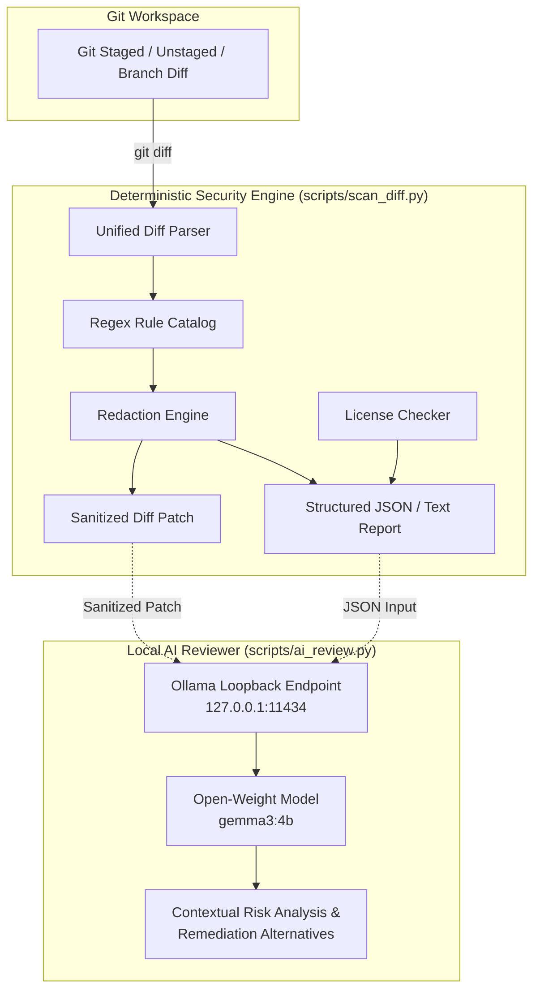
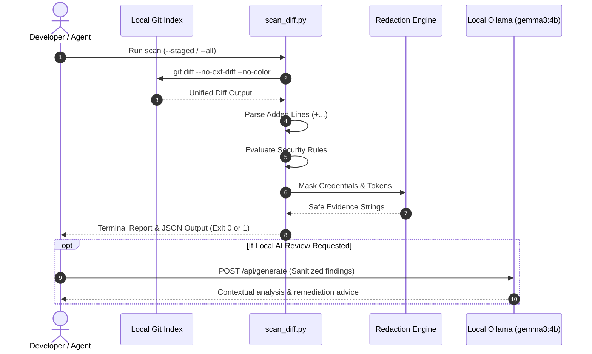

# Git Security Sentinel

**Catch risky Git changes before they become security incidents.**

[](https://github.com/Harry1402/git-security-sentinel/actions/workflows/security-scan.yml)
[](LICENSE)
[](https://www.python.org/)
[](https://agentskills.io/specification)

---

## 1. Project Overview

**Git Security Sentinel** is a privacy-first, zero-dependency security reviewer and Agent Skill for Git changes. It operates locally to identify accidentally exposed credentials, suspicious code execution patterns, unsafe configurations, and missing open-source licenses before code is committed or pushed.

By combining a deterministic Python static analysis engine with an optional local AI reviewer running through [Ollama](https://ollama.com/), Git Security Sentinel offers high speed, transparent rules, and intelligent contextual explanation without sending any code or credentials to external cloud APIs.

Compliant with the [Agent Skills Open Standard](https://agentskills.io/specification), Git Security Sentinel can be used directly by human developers in their terminals or integrated seamlessly into AI coding agents.

---

## 2. The Problem and Why It Matters

Accidental credential exposure in Git repositories is one of the most frequent causes of cloud compromise:
- **Permanent History**: Once committed and pushed to a public or team repository, revoking and scrubbing secrets is difficult and disruptive.
- **Automated Exploitation**: Attackers scan public GitHub commits within seconds of publication, automatically weaponizing exposed cloud access keys.
- **Dangerous Patterns**: Quick debugging hacks such as `eval()` or hardcoded loopback IP addresses often slip past peer reviews into production deployments.
- **Privacy Trade-offs with Cloud AI**: Many AI security tools require uploading sensitive uncommitted diffs to third-party cloud LLMs, violating enterprise confidentiality and data sovereignty policies.

Git Security Sentinel solves this by running entirely on local developer workstations, requiring **zero pip dependencies**, and keeping all scans and AI reviews strictly on the machine.

---

## 3. Solution and Architecture

Git Security Sentinel separates scanning into two decoupled systems:



1. **Deterministic Security Engine**: Inspects added diff lines using conservative, named regular expressions. It safely masks sensitive matches in place and produces reproducible JSON reports.
2. **Local AI Security Reviewer**: A standard-library HTTP client that interfaces exclusively with a local Ollama server running open-weight instruction models (such as `gemma3:4b`). It evaluates findings within the surrounding context, highlights likely false positives, and recommends safer code alternatives.

---

## 4. Key Features

- **Zero Pip Dependencies**: Runs out of the box using only Python's standard library (`re`, `subprocess`, `urllib.request`, `json`).
- **Flexible Diff Scopes**: Scan staged changes (`--staged`), unstaged changes (`--unstaged`), all local changes (`--all`), or branch comparisons (`--base main`).
- **Safe Redaction by Default**: Matched secret tokens are masked (`AKIA****************`) across console logs, JSON reports, sanitized diff patches, and AI prompts.
- **Privacy-Guaranteed AI Review**: Connects only to local loopback addresses (`127.0.0.1`); rejects non-loopback URLs by default.
- **Agent Skill Compliant**: Includes a fully compliant `SKILL.md` file following the Agent Skills Open Standard.
- **Open-Source License Check**: Verifies root repository compliance (`LICENSE`, `LICENSE.md`, `COPYING`).
- **Configurable Severity Exit Codes**: Integrates cleanly into CI pipelines, pre-commit hooks, and terminal scripts.

---

## 5. Example Workflow

### Developer Pre-Commit Check
```bash
# 1. Stage changes in Git
git add .

# 2. Run deterministic security scan with integrated local Gemma AI review
python scripts/scan_diff.py --staged --ai --ai-model gemma3:4b

# 3. Alternatively, save report and sanitized diff for standalone analysis
python scripts/scan_diff.py --staged --output report.json --redacted-diff-out patch.diff
python scripts/ai_review.py --report report.json --diff patch.diff --model gemma3:4b
```

---

## 6. Architecture Diagram



---

## 7. Repository Structure

```
git-security-sentinel/
├── SKILL.md                          # Agent Skills Open Standard specification
├── README.md                         # Project documentation and guide
├── LICENSE                           # MIT open-source license
├── .gitignore                        # Git ignore patterns
├── CONTRIBUTING.md                   # Contribution guidelines and coding conventions
├── SECURITY.md                       # Vulnerability reporting and security policy
├── .github/
│   └── workflows/
│       └── security-scan.yml         # GitHub Actions automated test & scan workflow
├── scripts/
│   ├── scan_diff.py                  # Deterministic static scanner (zero dependencies)
│   └── ai_review.py                  # Local Ollama AI reviewer (zero dependencies)
├── tests/
│   └── test_scan_diff.py             # Built-in unittest test suite
├── examples/
│   ├── clean-report.json             # Sample report with no findings
│   └── findings-report.json          # Sample report with redacted findings
└── references/
    └── detection-rules.md            # Detailed rule specifications and examples
```

---

## 8. Prerequisites

- **Python**: Version 3.9 or newer (tested on 3.9 through 3.14).
- **Git**: Installed and available in your system `PATH`.
- **Operating System**: Windows, Linux, or macOS.
- **Optional Local AI**: [Ollama](https://ollama.com/) installed and running locally on port `11434` if using AI contextual review.

---

## 9. Installation and Setup

Clone the repository directly into your local workspace:

```bash
git clone https://github.com/Harry1402/git-security-sentinel.git
cd git-security-sentinel
```

No package installation step (`pip install`) is required.

---

## 10. Static Scan Commands

The scanner provides intuitive CLI flags to examine code changes at various stages of development:

### Scan Staged Changes (Pre-Commit)
```bash
python scripts/scan_diff.py --staged
```

### Scan Unstaged Working Tree Changes
```bash
python scripts/scan_diff.py --unstaged
```

### Scan All Local Changes
```bash
python scripts/scan_diff.py --all
```

### Scan Branch Diff Against Base Branch
```bash
python scripts/scan_diff.py --base main
```

### Output Formats and File Generation
```bash
# Output JSON directly to stdout
python scripts/scan_diff.py --all --format json

# Save JSON report to file
python scripts/scan_diff.py --all --output scan-report.json

# Export a sanitized diff patch with secrets redacted
python scripts/scan_diff.py --all --redacted-diff-out sanitized.patch

# Scan an existing diff file or piped input
python scripts/scan_diff.py --diff-file my-changes.patch
git diff | python scripts/scan_diff.py --diff-file -
```

### Failure Thresholds and Exit Codes

| Exit Code | Meaning |
|---|---|
| `0` | Scan completed successfully; no findings meet or exceed `--fail-on` threshold. |
| `1` | Scan completed successfully; findings detected at or above `--fail-on` threshold (default: `high`). |
| `2` | Execution error (e.g. invalid arguments, missing Git, file not found). |

To configure failure behavior:
```bash
# Fail only on critical severity findings (e.g. private keys)
python scripts/scan_diff.py --all --fail-on critical

# Informational scan: always exit 0 unless an execution error occurs
python scripts/scan_diff.py --all --fail-on none

# Require local AI review to succeed (fails with exit code 2 if Ollama is unreachable)
python scripts/scan_diff.py --all --ai --require-ai
```

---

## 11. Local AI Setup and Usage

The AI reviewer provides human-readable explanations, false-positive classification, and safer code alternatives using open-weight models running on your local machine.

### Step 1: Install and Launch Ollama
- **Windows (PowerShell)**:
  ```powershell
  winget install Ollama.Ollama
  ```
- **macOS / Linux**: Download from [ollama.com/download](https://ollama.com/download).

Start the local daemon:
```bash
ollama serve
```

### Step 2: Pull the Recommended Gemma Model
We recommend **Gemma 3 (4B)** (`gemma3:4b`), an efficient open-weight model released by Google that runs comfortably on modern developer hardware:
```bash
ollama pull gemma3:4b
```
*Model Details*: Gemma 3 is released under the open [Gemma Terms of Use](https://ai.google.dev/gemma/terms). Alternative lightweight models such as `llama3.2:3b` or `mistral:7b` can also be used by passing `--ai-model <model-name>`.

### Step 3: Run the Local AI Review
```bash
# Option A: Integrated scan and AI review in a single command
python scripts/scan_diff.py --all --ai --ai-model gemma3:4b

# Option B: Standalone execution from an existing scan report
python scripts/scan_diff.py --all --output scan-report.json --redacted-diff-out sanitized.patch
python scripts/ai_review.py --report scan-report.json --diff sanitized.patch --model gemma3:4b
```

---

## 12. Sample JSON Report

```json
{
  "scanner": "git-security-sentinel",
  "version": "1.0.0",
  "status": "completed",
  "scan_mode": "all",
  "findings": [
    {
      "rule_id": "secret.github_pat_classic",
      "category": "secrets",
      "severity": "high",
      "confidence": "high",
      "file": "services/github_client.py",
      "line": 14,
      "message": "GitHub personal access token (classic) detected.",
      "evidence": "ghp_************************99",
      "recommendation": "Revoke this personal access token in GitHub Developer Settings and generate a new one."
    }
  ],
  "license": {
    "root_license_present": true,
    "license_file": "LICENSE"
  },
  "summary": {
    "total": 1,
    "critical": 0,
    "high": 1,
    "medium": 0,
    "low": 0,
    "info": 0
  },
  "errors": []
}
```

---

## 13. Detection Rules and Severity Definitions

| Rule ID | Category | Severity | Description |
|---|---|---|---|
| `secret.private_key` | `secrets` | **CRITICAL** | Cryptographic private key headers (RSA, EC, DSA, OpenSSH). |
| `secret.aws_access_key` | `secrets` | **HIGH** | AWS IAM Access Key Identifiers (`AKIA...`). |
| `secret.aws_secret_key` | `secrets` | **HIGH** | 40-character base64 AWS Secret Key assignments. |
| `secret.github_pat_classic` | `secrets` | **HIGH** | Classic GitHub Personal Access Tokens (`ghp_...`). |
| `secret.github_pat_fine_grained` | `secrets` | **HIGH** | GitHub Fine-Grained Personal Access Tokens (`github_pat_...`). |
| `secret.github_token_scoped` | `secrets` | **HIGH** | GitHub OAuth/App scoped tokens (`gho_`, `ghu_`, `ghs_`, `ghr_`). |
| `secret.slack_token` | `secrets` | **HIGH** | Slack API user, bot, or workspace tokens (`xoxb-`, `xoxp-`). |
| `secret.generic_credential` | `secrets` | **HIGH** | Variable assignments for passwords, tokens, or API keys. |
| `code.dangerous_eval` | `risky_code` | **MEDIUM** | Dynamic code execution (`eval()`, `exec()`). |
| `config.hardcoded_localhost` | `configuration` | **LOW** | Loopback endpoints (`127.0.0.1`, `localhost`). |

*Full documentation, false positive handling, and remediation examples are in [references/detection-rules.md](references/detection-rules.md).*

---

## 14. Privacy and Secret-Redaction Guarantees

Git Security Sentinel enforces strict privacy guardrails:
1. **Redaction Before Output**: All credentials matched by secret rules are masked at detection time. Unredacted secrets never appear in logs, JSON reports, or diff patches.
2. **Loopback-Only AI Requests**: `scripts/ai_review.py` connects only to local loopback addresses (`127.0.0.1` / `localhost`). External hosts are rejected unless overridden with `--allow-remote-host`.
3. **No External Network Calls in Scanner**: `scripts/scan_diff.py` has no network socket calls and operates entirely offline.
4. **Untrusted LLM Output**: The AI reviewer is advisory only. Model outputs can never edit files, dismiss findings, or modify exit codes.

---

## 15. GitHub Actions Integration

Git Security Sentinel includes a ready-to-use GitHub Actions workflow (`.github/workflows/security-scan.yml`):

```yaml
name: Security Scan & Test Suite

on:
  push:
    branches: [ main ]
  pull_request:
    branches: [ main ]

jobs:
  test-and-scan:
    runs-on: ubuntu-latest
    steps:
      - uses: actions/checkout@v4
        with:
          fetch-depth: 0

      - uses: actions/setup-python@v5
        with:
          python-version: "3.11"

      - name: Run Unit Tests
        run: python -m unittest discover -s tests -p "test_*.py" -v

      - name: Scan Pull Request Diff
        if: github.event_name == 'pull_request'
        run: python scripts/scan_diff.py --base origin/${{ github.base_ref }} --fail-on high
```

The CI check runs without API keys, third-party pip packages, or GPU dependencies.

---

## 16. Testing Instructions

Run the full automated test suite using Python's built-in `unittest` runner:

```bash
python -m unittest discover -s tests -p "test_*.py" -v
```

All 28+ unit and integration tests run in under 3 seconds without external network dependencies. Synthetic secrets are constructed programmatically in test code so the repository's git history remains completely free of leaked tokens.

---

## 17. Known Limitations and False Positives

- **Static Regex Scope**: Regular expressions cannot determine if an exposed API key is actively valid or permissions-restricted.
- **Generic Credential Heuristics**: Variable names containing `password` or `token` might match test fixtures or mock objects. Filter heuristics ignore common placeholder patterns, but human review is recommended for medium-confidence findings.
- **Dynamic Language Obfuscation**: Base64-encoded strings, dynamic string concatenations, or secrets split across multiple variables will not be detected by static line matching.
- **AI Model Hallucinations**: Local LLMs may provide inaccurate explanations or recommendations; always treat AI output as an advisory assistant.

---

## 18. Threat Model and Non-Goals

### Threat Model
- **In-Scope**: Detecting accidentally committed credentials, unencrypted private keys, high-risk dynamic evaluation (`eval`), and hardcoded endpoints introduced in new Git additions.
- **Out-of-Scope**: Full software composition analysis (SCA) for third-party CVE dependencies, memory corruption analysis, dynamic runtime penetration testing, or AST-based semantic taint analysis across entire projects.

### Non-Goals
- Git Security Sentinel does not modify or re-write your code automatically.
- It does not automatically run `git commit` or `git push`.
- It does not replace comprehensive enterprise SIEM/secret-management platforms (such as HashiCorp Vault or AWS Secrets Manager).

---

## 19. Contribution Guidelines

Contributions are welcome! Please review [CONTRIBUTING.md](CONTRIBUTING.md) for instructions on proposing rules, submitting pull requests, and adhering to our zero-dependency design principle.

---

## 20. Roadmap

- [ ] Git pre-commit hook installer script (`scripts/install_hook.py`).
- [ ] Support for GitLab CI and Bitbucket Pipelines templates.
- [ ] Extended rules for Azure access tokens, Google Cloud service account keys, and Stripe keys.
- [ ] Optional SARIF output format (`--format sarif`) for direct GitHub Advanced Security code scanning integration.
- [ ] Enhanced AST-based validation for Python and JavaScript diffs.

---

## 21. License

This project is licensed under the terms of the [MIT License](LICENSE).

---

## 22. Hacktoberfest Hack Day Ranchi 2026 Submission Context

- **Event**: Hacktoberfest Hack Day Ranchi 2026
- **Category**: **Best Open-Source AI Project**
- **Repository**: [https://github.com/Harry1402/git-security-sentinel](https://github.com/Harry1402/git-security-sentinel)
- **Standard**: Built in accordance with the [Agent Skills Open Standard](https://agentskills.io/specification).
- **Maintainer**: Harry1402 & Git Security Sentinel Contributors
